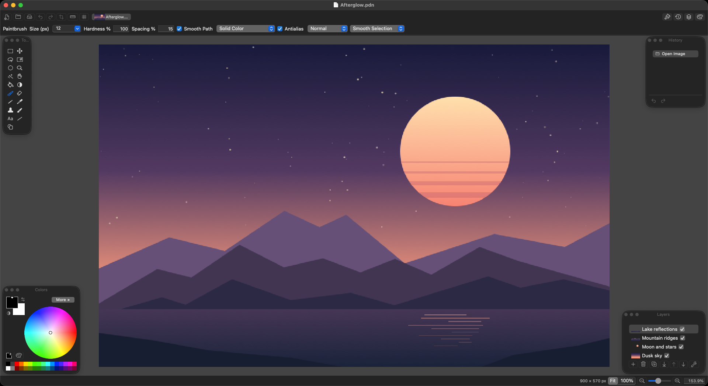

# paint.mac

paint.mac is an independent, faithful recreation of the Paint.NET editing experience on macOS. Open, edit, and save layered Paint.NET (`.pdn`) projects or export a flattened image.



Requires macOS 13 or later, Swift, and the macOS SDK.

```sh
sh build.sh
open .build/paint.mac.app
```

[User guide](docs/USER_GUIDE.md) · [Paint.NET 5.2 compatibility](docs/PARITY_5_2.md) · [MIT license](LICENSE)
